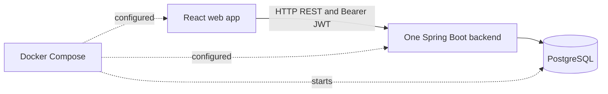

# TransportApp: coursework requirements gap analysis

Reviewed: 1 November 2026.

This document compares the source code with the supplied grade **S** system requirements and grade **P** tutorial requirement. The initial review made no code changes. A subsequent implementation increment on the same date added security fixes/tests and container configuration; this document now includes that progress. It is not a full runtime certification or a prediction of the examiner's final marks. See [BUILD_HANDOFF.md](BUILD_HANDOFF.md) for verified results and remaining work.

**Status:** Implemented = present in source; Partial = some required parts exist; Missing = no implementation found; Unverified = cannot establish from local files alone.

## 1. What you already have

- A Java 21 / Spring Boot backend with REST controllers, services, repositories, DTOs, validation, and error handling.
- PostgreSQL persistence for users, vehicles, and driver-to-vehicle assignments, including assignment history.
- Registration and login, BCrypt password hashing, signed JWTs, and role checks for `ADMIN`, `DRIVER`, and `CLIENT`.
- A React / TypeScript / Vite web app that calls the REST API and provides login, registration, profile, administration, and driver-related views.
- Backend/frontend Dockerfiles and full-stack Compose configuration, plus Swagger/OpenAPI dependencies and configuration. Compose syntax is verified; image builds and startup remain unverified.
- 25 passing security/JWT/admin-bootstrap tests using mocked persistence, environment configuration, and startup documentation.

**The main architectural gap:** this is currently one backend application and one frontend application. Multiple Java `@Service` classes are not independently deployed microservices.

### Current structure

This is an implementation overview, not a completed UML/C4 documentation set. Compose now configures all three containers; runtime startup is pending. The frontend container uses Nginx to proxy API calls to the backend.

## 2. Grade S: requirement checklist

The brief lists nine explicitly scored items worth 1 point each. The requirement to use more than two internal microservices is also stated, without a separate point value. Treat it as an architectural requirement; do not assume the REST point alone satisfies it.

| Requirement | Status | What exists | What is missing / needs to be done |
|---|---|---|---|
| Web server using **more than 2 internal microservices** | **Missing** | One Spring Boot application containing several service classes. | Introduce at least three independently runnable internal microservices and connect them through the web-facing server/API gateway. Give each a clear responsibility and deployment configuration. |
| Secured REST API — **1p** | **Implemented; live verification pending** | JWT authentication, BCrypt, method roles, account-state checks, and passing MVC/security tests. | Run PostgreSQL-backed smoke checks and admin/driver demonstrations; retain regression coverage during service extraction. |
| Scalability using load balancing or scalable WebSockets — **1p** | **Missing** | Stateless JWT authentication is a useful starting point. | Add, for example, Nginx balancing requests across at least two instances of one service. Demonstrate requests reaching both instances. A single reverse proxy forwarding to one instance is insufficient evidence of load balancing. |
| Message broker, e.g. RabbitMQ — **1p** | **Missing** | Business operations currently call Java services/repositories directly. | Add a broker and a real producer/consumer workflow, such as sending a driver assignment notification job. Demonstrate acknowledgements, retries, and handling of failed or duplicate messages. |
| Event streaming, e.g. Kafka — **1p** | **Missing** | Assignment history is stored in PostgreSQL; it is not an event stream. | Publish domain events to a stream and implement a consumer, for example an assignment audit projection. Demonstrate consumption and replay. |
| FaaS — **1p** | **Missing** | No function project, runtime, trigger, or invocation configuration found. | Add a function deployed to a FaaS runtime and invoke it from the system, for example calculating package volume/weight from dimensions. Show input, output, and deployment steps. An ordinary Spring service method does not meet this requirement. |
| Web app consuming REST **and receiving server-side notifications** — **1p** | **Partial** | React consumes REST using `fetch` with Bearer tokens. | Add authenticated SSE or WebSocket delivery and a UI that receives and displays pushed events. Verify with two browser sessions. Updating local state after an API call does not demonstrate server push. |
| Micro frontend architecture — **1p** | **Missing** | One Vite project with routes and React components. | Split a meaningful feature into a separately built/deployable frontend, composed into a host shell, for example an admin frontend and driver frontend. Routes/components alone are not micro frontends. |
| Containers deploying the solution — **1p** | **Partial; runtime unverified** | Backend/frontend Dockerfiles and Compose services with database persistence, proxying, and health dependencies. | Build/start images and verify workflows, then extend deployment to the future internal services/infrastructure. Kubernetes is not necessary if Docker meets the requirement. |
| UML and C4 system documentation — **1p** | **Missing** | A product requirements document exists. | Add UML diagrams and explicitly identified C4 models documenting the implemented system. Suggested minimum: UML domain/class and sequence diagrams; C4 system context and container diagrams. |

**Current position:** the secured REST API has substantial implementation, the web app and container requirements are partially covered, and the distributed architecture requirements remain to be built. Partial coverage should not be counted as a guaranteed full point.

## 3. Evidence in the repository

| Area | Files to inspect | What they establish |
|---|---|---|
| Backend stack | [pom.xml](Backend/pom.xml), [BackendApplication.java](Backend/src/main/java/org/transport/BackendApplication.java) | One Spring Boot application; web, persistence, security, validation, Actuator, JWT, and OpenAPI dependencies. |
| REST protection | [SecurityConfig.java](Backend/src/main/java/org/transport/config/SecurityConfig.java) | Stateless sessions; public auth/docs/health; admin-only other Actuator routes; authentication elsewhere; JWT filter and method security enabled. |
| JWT and passwords | [JwtService.java](Backend/src/main/java/org/transport/security/JwtService.java), [JwtAuthenticationFilter.java](Backend/src/main/java/org/transport/security/JwtAuthenticationFilter.java), [PasswordConfig.java](Backend/src/main/java/org/transport/config/PasswordConfig.java) | Token signing/validation, Bearer authentication, and BCrypt hashing. |
| Login/registration | [AuthController.java](Backend/src/main/java/org/transport/controller/AuthController.java), [AuthService.java](Backend/src/main/java/org/transport/service/AuthService.java) | Public registration creates clients; disabled accounts are refused at login. |
| Role restrictions | [UserController.java](Backend/src/main/java/org/transport/controller/UserController.java), [VehicleController.java](Backend/src/main/java/org/transport/controller/VehicleController.java), [AssignmentController.java](Backend/src/main/java/org/transport/controller/AssignmentController.java), [DriverController.java](Backend/src/main/java/org/transport/controller/DriverController.java) | Admin-only management operations and driver-only current-driver endpoint. |
| Business logic | [AssignmentService.java](Backend/src/main/java/org/transport/service/AssignmentService.java) | In-process transactional assignment workflow and database history; no broker or streaming integration. |
| Frontend REST usage | [client.ts](frontend/src/api/client.ts), [endpoints.ts](frontend/src/api/endpoints.ts), [AdminDashboard.tsx](frontend/src/pages/AdminDashboard.tsx) | Calls to backend endpoints with JWT headers and administration workflows. |
| Frontend composition | [package.json](frontend/package.json), [vite.config.ts](frontend/vite.config.ts), [App.tsx](frontend/src/App.tsx) | One frontend build and route tree; no micro frontend composition configured. |
| Containers | [docker-compose.yml](Backend/docker-compose.yml), [backend Dockerfile](Backend/Dockerfile), [frontend Dockerfile](frontend/Dockerfile) | PostgreSQL/backend/frontend configured with health dependencies; runtime unverified. |
| Runtime configuration | [application.properties](Backend/src/main/resources/application.properties) | `/api` context path, PostgreSQL configuration, JWT settings, Swagger UI, and Hibernate schema updates. |
| Planned features | [PRD.md](PRD.md) | Product intentions; these are not proof of implemented functionality. |

Source tests and application Dockerfiles have now been added. Broker/streaming integrations, FaaS implementation, push notifications, and a UML/C4 documentation set remain missing. Compiled output under `build`/`target` is not treated as the source of truth.

### Security follow-up status

- [x] Reject disabled accounts on JWT-authenticated requests; verify with an already-issued token. Roles are also reloaded on every request.
- [x] Require an environment JWT secret, remove the known fallback, and validate key length/lifetime.
- [x] Align auth-path exclusion with servlet paths excluding `/api`; test login with a stale Bearer header.
- [x] Add access tests covering missing/malformed/expired/wrong-signature tokens, roles, disabled/deleted users, and consistent JSON `401`/`403` responses.
- [x] Restrict public Actuator access to health; other exposed management endpoints require admin access.
- [ ] Run the live PostgreSQL/container smoke checks and admin/driver workflow demonstrations. Mocked persistence tests do not verify database behavior.

The PRD's statements that security is permissive and auth exists in multiple controllers do not match the reviewed source: the JWT filter is enabled, non-public routes require authentication, and auth endpoints are consolidated in `AuthController`.

## 4. A practical implementation path

This is a proposed direction, not existing functionality. Preserve the working code and extract responsibilities incrementally.

1. **Stabilize the current secured API.** Resolve the security follow-up items and document a reproducible login/admin/driver example.
2. **Establish the required service boundaries.** Use a web-facing gateway/server with at least three internal services, for example Identity, Fleet/Assignments, and Notifications. Reuse the existing auth and fleet logic. Each service should run independently and own its data access; avoid direct access to another service's tables.
3. **Containerize the full application.** Add images and Compose services for the frontend, gateway, internal services, and databases. Move hardcoded API/database addresses into deployment configuration.
4. **Add broker messaging and server push together.** Fleet publishes a RabbitMQ notification job after assignment; Notifications consumes it and pushes the result to the authenticated driver UI. Address database/message consistency, retries, and duplicate delivery.
5. **Add event streaming as a distinct workflow.** Publish assignment events to Kafka and consume them into an audit projection. Keep the purpose clear: RabbitMQ handles notification jobs; Kafka provides a replayable event history. Merely running both containers is insufficient.
6. **Demonstrate scalability.** Run two replicas of a service behind Nginx. If notification delivery is replicated, also ensure an event reaches the instance holding the user's connection, for example through shared pub/sub.
7. **Add a genuine FaaS integration.** Deploy a small deterministic calculation function and invoke it from a backend workflow. Package-volume calculation fits the planned transport domain, but package management itself is not yet implemented.
8. **Extract a micro frontend.** Introduce a host shell and independently built admin/driver features. Demonstrate independent builds and integration with authentication and API calls.
9. **Document and demonstrate the final system.** Write the UML/C4 models, startup instructions, environment variables, and a short reproducible demonstration for every scored item.

### Definition of done for the system submission

- [ ] A clean checkout can start the complete containerized system using documented commands.
- [ ] The web-facing server uses at least three independently runnable internal microservices.
- [ ] Secured API examples prove authentication and role-based authorization.
- [ ] Requests demonstrably reach multiple instances through a load balancer, or the alternative scalable WebSocket solution is demonstrated.
- [ ] A real message crosses the broker and is processed by a consumer.
- [ ] A domain event enters the event stream and is consumed/replayed.
- [ ] The application invokes a deployed FaaS function.
- [ ] A browser receives a server-pushed notification without refreshing.
- [ ] Independently built frontend features are composed into the web application.
- [ ] UML and C4 diagrams reflect the running implementation.

## 5. Grade P: approximately three-page tutorial

| Requirement | Status | Next action |
|---|---|---|
| Tutorial on a topic implemented in this system | **Missing** | Write the tutorial around a working, reproducible feature. JWT-based REST security is the strongest current candidate. |
| Approximately three pages | **Missing** | Draft a concise tutorial, then check its rendered length; Markdown length depends on the renderer. |
| Working example published in a public Git repository | **Unverified** | The configured remote is `https://github.com/romanioan10/Transport.git`. Local Git configuration does not prove public visibility or that the reviewed code has been pushed. Verify anonymous access and the published example before submission. |

### Suggested tutorial: Securing a Spring Boot REST API with JWT and roles

This uses existing work and can be completed after the security fixes and verification above. The tutorial itself is a separate deliverable; this gap analysis is not that tutorial.

| Approximate page | Content |
|---|---|
| 1: Setup and authentication | Explain the request flow, prerequisites and startup, required environment variables, BCrypt, client registration, login, and JWT issuance. Link the public repository and a reproducible commit/tag. |
| 2: Protecting endpoints | Explain token validation, the security filter chain, and method-level roles using the actual project files. Walk through an authenticated profile request and an admin-only operation. |
| 3: Demonstration and verification | Provide executable requests and expected results for valid, missing, expired, and wrong-role tokens; explain disabled-account handling and common setup errors. Include the relevant test/run commands. |

Tutorial completion checklist:

- [ ] The example runs from the exact public commit/tag linked in the tutorial.
- [ ] Prerequisites, database startup, secret configuration, backend startup, and example requests are documented.
- [ ] An administrator can be provisioned using documented steps without enabling public admin registration.
- [ ] Requests show both successful access and rejected access with actual observed responses.
- [ ] No real passwords, private tokens, or deployment secrets are published.
- [ ] The rendered tutorial is approximately three pages.

## 6. Keep the product plan and coursework plan aligned

The PRD mainly describes a backend-first product MVP. It plans synchronous database notifications and treats WebSockets as a future enhancement. Those choices do not yet fulfill this coursework's server-push requirement. Likewise, the planned monolithic MVP needs additional architecture work to satisfy the microservices, broker, streaming, FaaS, and micro frontend requirements.

Trips, trailers, bookings, packages, and capacity management described in the PRD should not be marked implemented based on the PRD alone. Use the existing user/vehicle/assignment workflow for early architecture demonstrations, and add new product features only where needed for the chosen example.
